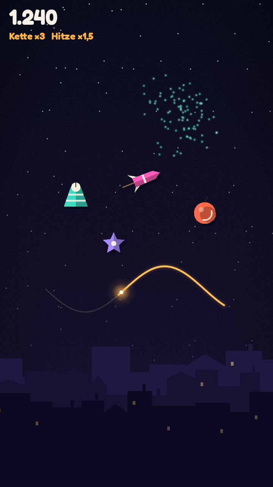

# Art Direction „Papiernacht“ (Agent F)

Abgeleitet aus der Mechanik: Feuerwerk über einer schlafenden Kleinstadt, alles wirkt wie ein Diorama aus Papier und
Tusche. Lesbarkeit vor Effekt: Gameplay-Objekte haben immer den stärksten Kontrast, der Hintergrund bleibt dunkel und ruhig.

## Prinzipien
1. **Ebenen statt Details:** Himmel (Shader) → Scherenschnitt-Skyline (3 Ebenen, nach vorne dunkler) → Lunte → Feuerwerk → Funken/Glühen → HUD.
2. **Papier-Objekte, Licht-Effekte:** Feuerwerkskörper sind matte Papierformen mit Zwei-Ton-Schattierung (links Licht, rechts −28 % Helligkeit)
   und Schlagschatten (5, 7) px. Alles, was brennt oder explodiert, ist additives Licht (eine weiche Glow-Textur, viele Quads).
3. **Formsprache = Regel:** Fontäne = Kegel (steigt auf), Rakete = Pfeilkörper mit Stab (zeigt Flugrichtung), Böller = Kugel
   (Radiusring sichtbar), Doppelzünder = Stern. Farbe allein trägt nie Information (Farbsehschwäche).
4. **Gefahr ist rot und pulsiert**, Belohnung ist warm-golden, Kühle (sichere Zone) ist blau.
5. **Morgengrauen als Zeitbudget:** Himmel und Horizont werden über 140 s wärmer; die Skyline bekommt Kontur.

## Palette
| Rolle | Farbe |
|---|---|
| Himmel oben / unten | `#0a0c1c` / `#1a1230` |
| Morgengrauen oben / Horizont | `#384574` / `#e88c63` |
| Skyline (hinten → vorne) | `#1d1940`, `#151233`, `#0c0a22`; Fenster `#ffcc73` (55 %) |
| Lunte (unverbrannt) | `#ffc15e` + Glühen `#ff9933` 18 % |
| Asche | `#3b3447`, verblasst in 5 s |
| Fontäne / Rakete / Böller / Doppelzünder | `#3fd9c0` / `#ff5cbc` / `#ff6b4a` / `#a98bff` |
| Papier-Details | `#f6efe0` |
| Text / gedämpft / Akzent | `#f6f1e7` / `#a9a7c4` / `#ffb347` |

## Typografie
Fredoka (SIL OFL 1.1): Bold für Zahlen und Buttons, Medium für Fließtext. Score ≥ 56 px, Hinweise ≥ 26 px (Basis 720 px Breite).

## Effekt-Budget (Performance & Barrierefreiheit)
- Max. ~900 gleichzeitige Partikel, eine Glow-Textur, additive Mischung, keine Post-Processing-Pässe.
- „Effekte reduziert“: halbe Partikelzahl, kein Bildschirmwackeln, kein Blitz. „Minimal“: nur funktionale Effekte.
